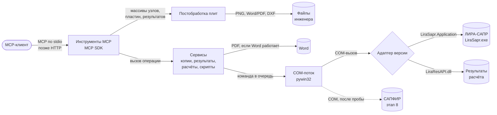

# Архитектура — Lira-Sapr-MCP

Status: approved 2026-10-27; изменения второй версии утверждены 2026-11-03

## Общая картина

Сервер — один процесс Python на компьютере с ЛИРОЙ. MCP-клиент (Claude, Codex, Hermes и
другие) запускает его сам и общается с ним через стандартный ввод-вывод (stdio). Внутри
процесса четыре слоя; каждый следующий ближе к ЛИРЕ. Пунктиром — части второй версии,
которых ещё нет в коде.

Как читать: стрелки — направление запроса, подписи — что передаётся. Путь одного
запроса: агент вызывает инструмент, например «прочитать таблицу узлов» → слой инструментов
проверяет параметры и через сессию (`services/session.py`) ставит команду в очередь
COM-потока → поток через адаптер версии обращается к ЛИРЕ → ответ идёт обратно тем же
путём. Сервисы, которым нужна ЛИРА (сводка модели, правка нагрузок), сами выполняются в
COM-потоке и получают адаптер параметром; сервисы без ЛИРЫ (резервные копии, обработка
результатов) работают в потоке инструментов. Окна-вопросы ЛИРЫ читаются и нажимаются
через Win32, а не COM (`adapters/dialogs.py`), поэтому это можно делать из любого потока:
пока COM-поток ждёт импорта текста, отдельный короткоживущий поток отвечает «Да» на
вопрос о монтажных таблицах.

## Части

| Часть | Отвечает за | Сделана на | Код | Страница |
|---|---|---|---|---|
| Инструменты MCP | Описания инструментов и ресурсов, проверка параметров, транспорт | MCP Python SDK 2.x | `src/lira_sapr_mcp/tools/` | [Сервер](components/server.md) |
| Сервисы | Резервные копии, обработка и экспорт результатов, задания расчёта, скрипты агента, справочник таблиц, правка нагрузок через текстовый формат, поиск элементов по признакам | Python, pandas | `src/lira_sapr_mcp/services/` | [Сервер](components/server.md) |
| COM-поток | Единственный поток, говорящий с ЛИРОЙ: очередь, тайм-ауты, события расчёта, поиск модальных окон | pywin32 | `src/lira_sapr_mcp/com/` | [Сервер](components/server.md) |
| Адаптеры версий | Поиск установленных ЛИР, различия версий, список возможностей | pywin32 | `src/lira_sapr_mcp/adapters/` | [Сервер](components/server.md) |
| Командная строка и диагностика | Флаги запуска (`--no-scripts`, `--version`), отчёт `--diagnose` об установленных ЛИРАХ и их API; не входит в слои сервера и ЛИРУ не запускает | Python (`argparse`), реестр Windows, pywin32 | `src/lira_sapr_mcp/__main__.py`, `diagnose.py` | [Эксплуатация](operations.md) |
| Постобработка плит (этап 6) | Плиты и опоры в сетке, прогибы относительно опор, изополя, мозаики армирования, DXF зон, отчёты Word/PDF; получает массивы, ЛИРУ и COM не знает. Чтение из ЛИРЫ — `services/slabs.py`, `services/mosaics.py`; PDF через Word — `adapters/word.py` | Python, numpy, matplotlib, ezdxf, python-docx, fpdf2 | `src/lira_sapr_mcp/postprocessing/` | [Плиты](components/slabs.md) |
| Адаптер САПФИРа (план, этап 8) | DXF по слоям и аналитика Revit → объекты САПФИРа → расчётная схема ЛИРЫ; место в схеме — по итогам пробы | pywin32 | — | [0004](decisions/0004-sapfir.md) |

Главный сценарий целиком: [от задачи до результата](flows/main-scenario.md).

## Стек

| Слой | Выбор | Почему, в одну строку | Решение |
|---|---|---|---|
| Архитектура | Один процесс, четыре слоя, COM-поток | Версии, диалоги и долгий расчёт без закрытия пути к сетевому режиму | [0001](decisions/0001-architecture.md) |
| Язык | Python 3.13 (64 бит) | COM, обработка данных и скрипты агента на одном языке | [0002](decisions/0002-python-stack.md) |
| MCP | Официальный MCP Python SDK 2.x | Поддерживается авторами протокола; stdio и HTTP | [0002](decisions/0002-python-stack.md) |
| COM | pywin32 | Зрелая библиотека COM, события, функции окон Windows | [0002](decisions/0002-python-stack.md) |
| Результаты | pandas, openpyxl (Excel) | Фильтры, сортировки, огибающие; самая известная агентам библиотека. Отбор, огибающие и сокращение ответа — на чистом Python; pandas и openpyxl пишут полные таблицы в CSV и Excel (с этапа 2) | — |
| Картинка модели | Win32 (pywin32) и стандартная библиотека | Снимок окна вида ЛИРЫ, PNG кодируется `zlib`; отдельная библиотека изображений не нужна (Pillow из первоначального плана не понадобилась, этап 3) | — |
| Постобработка плит | Модуль внутри сервера без ЛИРЫ | Один вызов агента, правила проверены тестами | [0003](decisions/0003-postprocessing.md) |
| Картинки результатов | matplotlib | Изополя по треугольной сетке и мозаики по элементам со своей шкалой | [0003](decisions/0003-postprocessing.md) |
| DXF | ezdxf | Запись зон доборов (этап 6) и чтение планов (этап 8) | [0003](decisions/0003-postprocessing.md) |
| Отчёты Word/PDF (этап 6) | python-docx; PDF — установленный Word через COM, а если он не может (не активирован, нет Word) — fpdf2 | PDF как Word, где Word работает; без Word — всё равно PDF | [0005](decisions/0005-reports.md) |
| Сборка моделей из DXF и Revit (план) | САПФИР через COM, после пробы; запасной путь — gmsh | Родная сетка ЛИРЫ-САПФИРа; косая геометрия | [0004](decisions/0004-sapfir.md) |
| Настройки | Файл TOML | Читается стандартной библиотекой Python | — |
| Окружение и установка | uv, `.venv`; у пользователей `uvx` | Одна команда установки с GitHub | — |
| Тесты | pytest | Модульные — на поддельном адаптере; интеграционные — на живой ЛИРЕ | — |
| Качество кода | ruff (проверка и форматирование), pre-commit | Один быстрый инструмент | — |
| Документация | Zensical | Сайт проекта для владельца | — |

## Данные

Базы данных нет. Сервер хранит:

- **Настройки** — файл TOML (папка резервных копий, тайм-ауты, год версии ЛИРЫ при
  нескольких установках). Без файла работают умолчания.
- **Резервные копии моделей** — папка рядом с моделью; сервер их не удаляет.
- **Выгрузки результатов** — CSV/Excel в папке, которую указал агент или пользователь.
- **Журнал** — файл в папке данных пользователя; в stdio-режиме вывод в консоль занят
  протоколом.
- **Задания расчёта** — только в памяти процесса; после перезапуска сервер о прошлом
  расчёте не знает, но его результаты и протокол читаются из файлов ЛИРЫ по пути модели.
- **Метки расчёта** — маленький JSON `<имя модели>.lira-mcp.json` в рабочей папке ЛИРЫ
  рядом с её результатами: какая модель (полный путь) рассчитана сервером и когда.
  По ним сервер предупреждает, что результаты принадлежат одноимённой модели или
  устарели (2026-10-29, разбор технического долга).

## Внешние сервисы

Нет. Нужна только локальная ЛИРА-САПР с действующей лицензией пользователя.

## Запуск и проверка

MCP-клиент запускает сервер командой из `Project commands` в `AGENTS.md`. Проверка:
модульные тесты без ЛИРЫ при каждом коммите; интеграционные и сквозные тесты на живой
ЛИРЕ 2024 R2 перед завершением задачи, работающей с ЛИРОЙ. Тестовые модели создаются
в папке проекта; модели пользователя тесты не трогают.

Сервер остаётся для Windows обычным фоновым процессом: Windows может замедлять его и переносить на
экономичные ядра, поэтому время одного и того же расчёта плавает, до 2,5 раза. Просьбу не замедлять
пробовали и убрали: решение владельца (2026-11-05), работа агента не должна мешать программам, в
которых работает пользователь.

## Журнал решений

| # | Дата | Решение | Утвердил | Статус |
|---|---|---|---|---|
| [0001](decisions/0001-architecture.md) | 2026-10-27 | Локальный сервер, четыре слоя, COM-поток, диалоги ЛИРЫ (П6) | владелец | accepted |
| [0002](decisions/0002-python-stack.md) | 2026-10-27 | Python, MCP Python SDK, pywin32 | владелец | accepted |
| [0003](decisions/0003-postprocessing.md) | 2026-11-03 | Постобработка плит — модуль внутри сервера, без ЛИРЫ | владелец | accepted |
| [0004](decisions/0004-sapfir.md) | 2026-11-03 | Сборка моделей из DXF и Revit через САПФИР после пробы; запасной путь — gmsh | владелец | accepted |
| [0005](decisions/0005-reports.md) | 2026-11-03 | Отчёты: python-docx, PDF через Word, без Word — fpdf2 | владелец | accepted |
