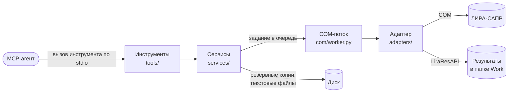
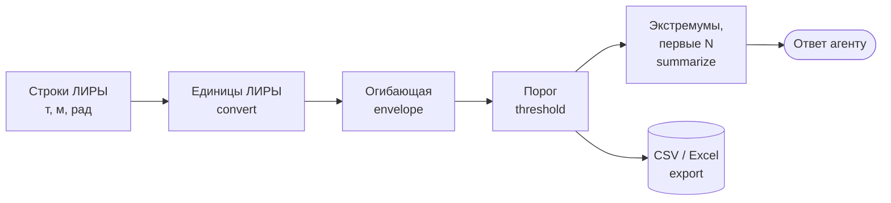

# Сервер

!!! info "Построено: этапы 1–6"
    Работают все 47 инструментов таблицы ниже: сведения и файлы, таблицы ввода,
    нагрузки, расчёт, все виды результатов с огибающими и выгрузкой, правка, указание
    элементов, скрипт, диалоги, картинка модели и плиты (этап 6).

## Что делает

Принимает вызовы инструментов от MCP-агента, выполняет их в ЛИРЕ-САПР через COM и
возвращает компактный результат. Отвечает за безопасность моделей (резервные копии,
отказ закрыть несохранённую модель), за то, чтобы ЛИРА не «повесила» агента
(тайм-ауты), и за различия версий ЛИРЫ.

## Место в архитектуре



Как читать: слева направо идёт вызов агента, каждый прямоугольник — слой кода с его
папкой в `src/lira_sapr_mcp/`. Агент видит только инструменты. Говорить с ЛИРОЙ может
только COM-поток и только через адаптер; результаты расчёта адаптер читает отдельной
библиотекой ЛИРЫ `LiraResAPI` из файлов в рабочей папке.

## Как устроено внутри

### Инструменты MCP

Сорок семь инструментов, все с префиксом `lira_`. Инструменты только для чтения помечены
для агента признаком `readOnlyHint`.

| Группа | Инструменты | Код |
|---|---|---|
| Сведения и файлы | `lira_status`, `lira_list_models`, `lira_open_model`, `lira_create_model`, `lira_save_model`, `lira_close_model`, `lira_model_summary`, `lira_list_backups`, `lira_restore_backup` | `tools/files.py` |
| Таблицы ввода | `lira_list_input_tables`, `lira_read_table`, `lira_write_table` | `tools/tables.py` |
| Нагрузки и текстовый формат | `lira_read_loads`, `lira_set_loads`, `lira_import_text_model`, `lira_export_text` | `tools/tables.py` |
| Расчёт | `lira_run_analysis`, `lira_analysis_status`, `lira_stop_analysis`, `lira_analysis_protocol`, `lira_delete_results`, `lira_punching_check` (проверка продавливания — команда меню ЛИРЫ через `StartCmd`) | `tools/analysis.py` |
| Результаты | `lira_node_displacements`, `lira_element_forces` (стержни, пластины, объёмные и специальные КЭ; формы динамических загружений и их суммарные значения — строка `shape: "sum"`) | `tools/results.py` |
| РСН и РСУ | `lira_load_combinations`, `lira_combination_displacements`, `lira_combination_forces` (по предельным состояниям), `lira_design_forces` (с критерием, группой и составом загружений) | `tools/results.py` |
| Динамика, арматура, узловые нагрузки | `lira_periods` (периоды, частоты, модальные массы), `lira_reinforcement` (подобранная арматура стержней и пластин, трещины), `lira_fragment_loads`, `lira_punching_loads` (по формам динамики и суммарные, `shape: "sum"`) | `tools/results.py` |
| Аргументы запроса результатов | у всех инструментов результатов, кроме списков РСН и периодов: `components`, `sort_by`, `by_abs`, `top`, `threshold`, `envelope`, `export_path` (см. «Сервисы») | `tools/results.py` |
| Правка модели (высокий уровень) | `lira_add_nodes`, `lira_add_elements`, `lira_set_stiffness`, `lira_copy_stiffness`, `lira_set_restraints`, `lira_self_weight` | `tools/editing.py` |
| Указание элементов | `lira_selection` (выделенное в окне ЛИРЫ или видимое после фрагментации), `lira_find_elements` (по признакам); слова `selected` и `visible` вместо номеров принимают правка, чтение таблиц и нагрузок, результаты (функция `numbers_in`); замена нагрузок и запись таблиц — только номера; в правке `visible` без фрагмента отклоняется | `tools/selection.py`, `tools/common.py` |
| Скрипт агента | `lira_run_script` | `tools/script.py` |
| Диалоги ЛИРЫ | `lira_dialogs`, `lira_press_dialog_button` | `tools/dialogs.py` |
| Картинка модели | `lira_model_picture` | `tools/files.py` |
| Плиты | `lira_slab_deflections` (прогиб относительно опор по СП 20, изополя, отчёт), `lira_cracked_copy` (копия с kE), `lira_slab_reinforcement` (мозаики AS1–AS4, DXF зон, отчёт) — [плиты](slabs.md) | `tools/slabs.py` |

Кроме инструментов, сервер отдаёт агенту **MCP-ресурс** `lira://reference/tables` —
справочник столбцов таблиц ввода, кодов типов КЭ, типов моделей и текстового формата
(`src/lira_sapr_mcp/reference/tables.md`). API ЛИРЫ не отдаёт заголовков столбцов,
поэтому справочник составлен по справке ЛИРЫ (`LiraSapr.chm`, окно «Таблицы ввода»,
которое таблицы API повторяют) и сверен с шириной строк всех таблиц в примерах ЛИРЫ. В
нём отмечено, что проверено тестами сервера, а что взято из справки; unit-тест следит,
чтобы справочник описывал все 31 таблицу из библиотеки типов ЛИРЫ.

Описание каждого инструмента — в его docstring: MCP-клиент показывает его агенту как
инструкцию. Ошибки ЛИРЫ и неверные аргументы декоратор `lira_errors`
(`tools/common.py`) превращает в ошибку инструмента с понятным текстом: что не так и
что сделать.

### Сервисы

- **Сессия** (`services/session.py`, класс `LiraSession`): выбирает установленную ЛИРУ,
  создаёт адаптер, при первом вызове подключается к ЛИРЕ и передаёт задания в COM-поток.
- **Резервные копии** (`services/backups.py`): перед первой правкой или перезаписью
  файла в сессии копируют `.lir` в папку `lira-mcp-backups` рядом с моделью с меткой
  времени в имени. Правка нагрузок (`lira_set_loads`) пересобирает файл целиком, а при
  согласии пользователя ещё и упаковывает схему, поэтому копию делает перед каждым
  вызовом (`backup_before_change(..., fresh=True)` в `tools/common.py`). Откат (`lira_restore_backup`) сначала копирует текущий файл туда же,
  затем кладёт выбранную копию на место модели; открытую модель сервер закрывает и
  открывает снова. Поэтому повторный откат к самой новой копии отменяет предыдущий.
- **Сводка модели** (`services/models.py`): число узлов и элементов, элементы по типам
  КЭ, жёсткости, загружения и единицы измерения — чтобы агент понял модель за один вызов.
  Раздел «results» говорит, есть ли у модели результаты расчёта и когда они записаны.
  Наличие сервер узнаёт запросом `MainData` библиотеки результатов: он отдаёт число
  узлов и элементов рассчитанной схемы. Если оно не совпадает с моделью, результаты
  принадлежат другой версии модели или одноимённой модели из другой папки — сводка
  предупреждает об этом. Кроме того, сводка и каждый инструмент результатов передают
  предупреждение меток расчёта (`adapters/stamps.py`, ниже).
- **Метки расчёта** (`adapters/stamps.py`): ЛИРА кладёт результаты в рабочую папку под
  именем модели без пути. После каждого своего расчёта сервер пишет рядом метку
  `<имя>.lira-mcp.json`: путь модели, время результатов и время файла модели. При
  чтении результатов он сравнивает их с моделью: результаты другой модели с тем же
  именем называет («These results are of …»), модель, сохранённую после расчёта,
  отмечает как, возможно, устаревшую. Содержимое файла сравнить нельзя: ЛИРА
  пересохраняет модель в конце расчёта и даже без изменений пишет другие байты. Когда
  сервер сохраняет модель, которую только читал, метка переносится на новое время файла,
  чтобы не было ложной тревоги. Расчёт, запущенный в окне ЛИРЫ, метку не оставляет:
  тогда сравнивается только время файлов с допуском 60 с на сохранение самой ЛИРОЙ.
- **Операции высокого уровня** (`services/operations.py`): добавить узлы и элементы
  (номера — после последних), назначить жёсткость, создать жёсткость копией
  существующей с другими параметрами (например, шириной сечения `B`), задать связи
  узлов. Каждая операция сначала проверяет аргументы по модели (есть ли такие узлы,
  элементы, жёсткость), затем пишет в таблицу ввода только свои строки; ЛИРА проверяет
  их и при ошибке ничего не меняет. В копии жёсткости сервер сбрасывает производные
  величины (`EF`, `EIy`, … = −1), чтобы ЛИРА пересчитала их по новому сечению. Копия
  пишется вместе с жёсткостями, не назначенными ни одному элементу: при записи части
  таблицы ЛИРА выбрасывает остальные неназначенные, а запись всей таблицы отклоняет в
  моделях со стальными сечениями. После записи сервер сверяет прежние жёсткости.
  Удалить элемент через API ЛИРЫ нельзя, поэтому если ЛИРА приняла новые элементы, но
  отклонила их жёсткость, ответ называет элементы, оставшиеся без неё.
  Собственный вес — метод ЛИРЫ `SetDeadWeightLoad`: нагрузки типа 16 в указанное
  загружение.
- **Указание элементов** (`adapters/com_adapter.py`, метод `selection`;
  `services/elements.py`). Выделенное в окне ЛИРЫ сервер берёт методом `GetSelection`,
  видимое — таблицами ввода по видимой части модели; выделение пользователя при этом не
  меняется. Собственный вес выделяет элементы сам (так работает `SetDeadWeightLoad`) и
  после этого возвращает выделение пользователя. Поиск по признакам читает таблицы элементов, жёсткостей, узлов, блоков и
  материалов целиком (на модели в 245 тыс. элементов — около 6 с) и оставляет элементы,
  которые подходят под все условия; у отметки Z в заданном диапазоне должны лежать все
  узлы элемента. Ответ — номера диапазонами (`1-10 25`) с числом по типам КЭ и
  жёсткостям, чтобы агент показал инженеру, что нашёл, до правки.
- **Скрипт агента** (`services/scripts.py`): выполняет Python-код агента в COM-потоке —
  для всего, чего нет в отдельных инструментах. Скрипту доступны объект приложения ЛИРЫ
  (`lira`), документ модели (`doc`), адаптер сервера (`adapter`) и константы библиотеки
  типов (`constants`); значение он возвращает переменной `result`, вывод `print`
  собирается отдельно (настоящий stdout занят протоколом MCP). Перед запуском сервер
  делает резервную копию модели. Предел времени останавливает Python-код между
  строками (через `sys.settrace`); один COM-вызов, который завис в ЛИРЕ, он не
  прервёт — тогда агент получает тайм-аут COM-потока. Скрипт выполняется с правами
  сервера: полный доступ к ЛИРЕ, файлам и Python (так решено в PRODUCT.md).
- **Нагрузки** (`services/loads.py`, `services/textformat.py`): в API 2024 R2 нет
  таблицы ввода нагрузок, поэтому сервер выгружает модель в текстовый формат ЛИРЫ,
  заменяет в нём документы нагрузок и загружает текст обратно. Затем он сверяет все
  таблицы новой модели со старой; при любом расхождении новая модель отбрасывается, а
  исходная остаётся нетронутой. Если новую модель не удалось сохранить поверх исходной,
  сервер открывает исходную снова. С указанными элементами и узлами (`Targets`) сервер
  читает и заменяет только нагрузки на них, а все остальные нагрузки модели переносит
  из выгрузки как есть: агенту не нужно передавать через себя миллион нагрузок, чтобы
  поправить нагрузку на одну плиту. Замена принимает только номера, а не слова
  `selected` / `visible`: выделение могло измениться между чтением и правкой, и тогда
  сервер заменил бы нагрузки не у тех элементов. Номера агент берёт из ответа
  `lira_read_loads`. Узловые нагрузки — типы 0 и 60, на элементы — 4, 6, 7, 9, 15, 16, 17
  и 26 (установлено пробами, [находки](../research/lira-api.md)). Для другого кода
  частичная замена отказывает, а чтение помечает нагрузку `target_kind_unknown`.
- **Результаты** (`services/results.py`): переводят значения из единиц библиотеки
  результатов (т, т·м, м, рад) в единицы, выбранные в ЛИРЕ, и сокращают ответ. Агент не
  получает тысячи строк, если о них не просил.

Все инструменты результатов принимают одни и те же аргументы запроса и проводят строки
через один путь (функция `reduce_tables` в `services/results.py`):



Как читать: строки идут слева направо; каждый шаг — функция `services/results.py`,
необязательные шаги пропускаются, если агент их не просил.

1. **Единицы** — перевод в единицы, выбранные в ЛИРЕ; порог задаётся уже в них.
2. **Огибающая** (`envelope=true`) — по каждому месту (узел или элемент с сечением)
   минимум и максимум каждой компоненты по всем загружениям, сочетаниям, формам и
   предельным состояниям, с указанием, где каждый достигнут (`My_max_at`). В колонке
   `My` остаётся больший по модулю из двух — по ней сортируют и отбирают порогом, а
   экстремумы ответа берутся из `My_min` и `My_max`.
3. **Порог** (`threshold`) — остаются строки, где компонента `sort_by` по модулю (или со
   знаком) не меньше заданного значения. Порог идёт после огибающей, чтобы она
   учитывала все загружения.
4. **Сокращение** (`summarize`) — минимум и максимум каждой компоненты с местом,
   сортировка, первые N строк (не больше 500).
5. **Экспорт** (`export_path`) — полная таблица после порога и огибающей, без
   ограничения N, пишется в `.csv` (одна таблица, колонка `family` для семейств КЭ) или
   `.xlsx` (лист на семейство) через pandas и openpyxl. В заголовках колонок — единицы
   своего семейства («My, kN*m» у стержней, «My, kN*m/m» у пластин — разные колонки). Путь должен быть абсолютным; ответ называет файл и число строк.

### COM-поток

COM требует вызывать объект ЛИРЫ из того потока, в котором он создан. Поэтому сервер
держит один поток (`com/worker.py`, класс `ComWorker`), который выполняет задания по
очереди, а между заданиями прокачивает сообщения Windows — так до сервера доходят
события ЛИРЫ «расчёт начат / закончен / остановлен».

```python title="src/lira_sapr_mcp/com/worker.py"
--8<-- "src/lira_sapr_mcp/com/worker.py:run_job"
```

Поток берёт задание, запоминает его имя (его покажет сообщение о тайм-ауте), выполняет
и передаёт результат или ошибку ожидающему вызову. Перед передачей ошибки он очищает
локальные переменные в её трассировке: там часто остаются ссылки на объекты ЛИРЫ,
которые иначе освободились бы в чужом потоке с ошибкой COM.

Прервать задание, которое уже выполняется в ЛИРЕ, поток не может. Поэтому при тайм-ауте
он различает два случая:

- задание ещё стояло в очереди — оно снимается, агент получает «вызов не выполнен»;
- задание уже выполняется — оно помечается просроченным, агент получает «ещё
  выполняется и может изменить модель; не повторяйте». Пока оно не закончится, новые
  вызовы сразу получают отказ «ЛИРА занята …», а не ждут в очереди своего тайм-аута.
  Когда оно закончится, `lira_status` покажет, чем (`last_call_finished_after_time_out`:
  успех или текст ошибки).

**Диалоги ЛИРЫ** (`adapters/dialogs.py`). Когда ЛИРА ждёт пользователя в модальном
окне, COM-вызов может зависнуть, поэтому окна ищутся не через COM, а функциями Windows
(Win32) в отдельном потоке. Диалог — видимое окно процесса `LiraSapr.exe`, владелец
которого — заблокированное им окно ЛИРЫ (модальное окно), или окно стандартного класса
диалога `#32770` без владельца (окно сообщения). Немодальные панели того же класса, при
которых ЛИРА доступна, диалогами не считаются. Текст полей сервер запрашивает у самого
окна сообщением `WM_GETTEXT` (с пределом ожидания): функция `GetWindowText` не читает
введённый текст полей окна чужого процесса.

Перед каждым заданием сессия запоминает, какие диалоги уже открыты. Если задание не
уложилось в тайм-аут, сессия ищет диалоги и добавляет в сообщение об ошибке их
заголовок, текст и кнопки, разделяя открытые во время вызова (на них агент может
ответить) и открытые раньше (возможно, пользователем: агенту сказано попросить
пользователя). То же делает статус расчёта `needs_user`. Агент может нажать кнопку
инструментом `lira_press_dialog_button`: сервер отправляет кнопке сообщение `BM_CLICK`
без ожидания.

### Картинка модели

У API ЛИРЫ нет экспорта изображения, а копирование через буфер обмена затёрло бы буфер
пользователя. Поэтому `lira_model_picture` (`adapters/picture.py`) делает модель
активной, переключает вид (изометрия, XOZ, XOY или текущий) и вписывает её в окно
командами меню ЛИРЫ, а затем просит окно вида нарисовать себя в картинку (функция
Windows `PrintWindow`). Окно вида — активное окно документа внутри главного окна ЛИРЫ
(сервер спрашивает его сообщением `WM_MDIGETACTIVE`), если его заголовок — имя модели
целиком: модель «frame» не спутается с открытой рядом «frame2». Пиксели читаются функцией `GetDIBits` в 32-битном формате при любой глубине цвета экрана
(в том числе 16 бит на удалённом рабочем столе). PNG сервер кодирует сам (zlib), без
новых библиотек, и обрезает белые поля — уже вне COM-потока (`picture_png` в
`asyncio.to_thread`), так что ЛИРА в это время свободна; картинка 4K готова примерно
за 0,1 с. На время снимка поток учитывает масштаб экрана (DPI): иначе при масштабе
125 % Windows сообщает уменьшенный размер окна, и в картинку попадает только его угол.
Окно ЛИРЫ не должно быть свёрнуто.

### Адаптер

- **Поиск установок** (`adapters/discovery.py`): читает реестр Windows и находит ЛИРЫ,
  зарегистрированные как `LiraSapr.Application.<год>` (2024) или
  `LiraSapphire.Application.<год>` (2025 и новее). По умолчанию выбирается новейшая
  поддерживаемая, в настройках можно задать год.
- **COM-адаптер** (`adapters/com_adapter.py`, класс `ComLiraAdapter`): открывает,
  создаёт, сохраняет и закрывает документы; читает и пишет таблицы ввода через временную
  таблицу `lira-mcp-<процесс>-<id>` и удаляет её, а заодно и оставленные сбоем или
  завершившимся процессом сервера (перед сохранением тоже); выгружает текстовый формат (команда меню 5049); запускает расчёт и следит за
  ним по событиям (`adapters/analysis.py`). Список возможностей и таблиц он читает из
  библиотеки типов ЛИРЫ (методы приложения и интерфейса документа `ILiraDocument`), а не
  задаёт вручную, — поэтому новые версии подхватываются без правки кода, если не меняют
  сами интерфейсы.
- **Библиотеки типов** (`adapters/typelibs.py`): библиотека типов — файл, описывающий
  интерфейсы, методы и константы COM API. ЛИРА регистрирует две: приложения
  (`LiraSapr.exe`) и результатов (`LiraResAPI.dll`, имя `LiraSaprRes`). Библиотекой
  результатов версии считается зарегистрированная из папки этой версии; если такой нет
  или её класс не читается, берётся библиотека ЛИРЫ 2024 R2 целиком (номер библиотеки,
  версия и класс никогда не смешиваются из двух версий). Тот же модуль выгружает содержимое библиотек для
  отчёта `--diagnose` (`diagnose.py`).
- **Возможности версии** (`tools/common.py`, декоратор `needs`): инструмент, которому
  нужна функция API ЛИРЫ, объявляет её, например `@needs(session, "StartAnalysis")`.
  Если в подключённой ЛИРЕ такой функции нет, инструмент сразу отвечает понятной ошибкой
  («lira_run_analysis needs StartAnalysis of LIRA's API, which LIRA 2025 does not have»)
  и ничего не делает. `lira_status` перечисляет такие инструменты в поле
  `tools_this_lira_cannot_run`. Если сервер ещё не подключён к ЛИРЕ, первый такой вызов
  подключается, чтобы узнать возможности. Инструменты регистрируются независимо от
  версии: агент видит один и тот же набор, а версия ЛИРЫ ограничивает только то, что
  можно выполнить. Единственное исключение задаёт пользователь: с флагом `--no-scripts`
  сервер не регистрирует `lira_run_script` (`server.py`, `build_server(scripts=False)`).

```python title="src/lira_sapr_mcp/tools/common.py"
--8<-- "src/lira_sapr_mcp/tools/common.py:needs"
```
- **Чтение после чтения:** ЛИРА помечает модель изменённой, даже когда сервер её только
  читал (временная таблица). Сервер помнит такие пометки, но тогда не видит правок,
  сделанных владельцем в окне ЛИРЫ. Поэтому модель, которую сервер только читал, перед
  закрытием и перед расчётом сохраняется (после резервной копии), а не закрывается с
  потерей возможных правок.
- **Чтение результатов** (`adapters/results.py`, класс `ResultsReader`): обращается к
  `LiraResAPI`. Для каждого запроса создаётся новый объект библиотеки: повторный запрос
  через тот же объект в ЛИРЕ 2024 возвращает мусор (см.
  [исследование](../research/lira-api.md)).

## Данные

Настройки (TOML), журнал, резервные копии и временные текстовые файлы — см.
[эксплуатацию](../operations.md) и раздел «Данные» в [архитектуре](../ARCHITECTURE.md).
Свои файлы сервер пишет только в папку резервных копий рядом с моделью, во временные
папки для текстового формата (удаляются сразу; одноимённый файл пользователя
возвращается на место) и в `%APPDATA%\lira-sapr-mcp`.

## Тесты

- Модульные (`tests/test_*.py`, `uv run pytest`) — без ЛИРЫ, на поддельном адаптере
  `tests/fakes.py`: очередь и тайм-ауты, поиск установок, настройки, текстовый формат,
  протокол расчёта, обработка результатов, плиты ([постобработка](slabs.md): сетка,
  прогибы, мозаики, DXF, отчёты), учёт правок модели в адаптере (на подставных
  COM-объектах), инструменты через MCP-клиент в памяти и запуск сервера отдельным
  процессом по stdio.
- На живой ЛИРЕ (`tests/live/`, `uv run pytest -m lira`) — адаптер, нагрузки, расчёт и
  сквозной пример №1: MCP-клиент строит раму, рассчитывает её и сверяет моменты с ручным
  расчётом; пример №4 (`test_live_large.py`): каркас из 11 264 стержней, сгенерированный
  текстом, — 10 наибольших моментов одним запросом (чтение ~2 с). Тесты работают только с моделями в `tests/live/_work` и закрывают только то,
  что открыли сами.

## Ограничения

- Одна ЛИРА на процесс сервера; команды выполняются последовательно.
- Скрипт агента не изолирован: он может всё, что может процесс сервера. Флаг запуска
  `--no-scripts` убирает этот инструмент.
- Правка нагрузок через текстовый формат: импорт текста всегда путает виды загружений,
  и сервер возвращает их записью таблицы `LoadCases`. Это получается только у моделей
  с нормами сочетаний ЛИРЫ по умолчанию (СП 20.13330). У моделей по другим нормам
  (например, СНиП 2.01.07-85\*) виды не возвращаются («2: Длительное(Д) -> Постоянное
  ( P)»). Способа сохранить другие нормы в API 2024 R2 не нашлось — см. «Находки T25»
  в [исследовании API](../research/lira-api.md).
- Перед пересборкой сервер проверяет, упакована ли схема (`numbering_gaps`: номера
  узлов и элементов без пропусков). Неупакованную схему импорт текста вернул бы с
  удалёнными узлами, поэтому без согласия пользователя сервер отказывает, а с
  `pack=true` упаковывает её через панель ЛИРЫ «Упаковка» только по удалённым узлам и
  элементам (`ComLiraAdapter.pack_scheme`), сохраняет и на этом останавливается:
  номера изменились, нагрузки агент читает заново. На модели владельца упаковка
  сохранила координаты, узлы элементов (в новой нумерации), жёсткости и стадии.
- Выгрузка текста (`_export_text`) у модели, связанной с моделью грунта, отвечает на
  вопрос «пересчитать C1/C2 и сваи?» без пересчёта; ждёт, пока ЛИРА дописывает большой
  текст (тайм-аут — от последнего роста файла) и отпустит его, а затем — пока допишет
  `<имя>.ald` и файл стадий: ЛИРА пишет их после текста (`finished_companions`). Если
  выгрузка сорвалась, одноимённые файлы пользователя остаются отложенными до
  следующего запуска сервера, чтобы поздняя запись ЛИРЫ их не затёрла.
- Что пересборка делает, чтобы модель совпала с исходной (`services/loads.py`):
    - кладёт рядом с текстом файлы, которые ЛИРА пишет при выгрузке: стадии монтажа (в
      папку Data под именем из строки 40 документа 0: у модели `м(1)` это `м{1}.mnt`) и
      `<имя>.ald` (плотности, цвета, конструктивные блоки, папка Work). Импорт читает их
      под именем текстового файла (`м(1).mnt`, `м(1).ald`) и спрашивает «импортировать
      монтажные таблицы?» — адаптер отвечает «Да» (`ComLiraAdapter._watching_import`).
      Если ЛИРА не может разобрать текст («Неизвестная ошибка при разборе …»), адаптер
      закрывает её сообщение и возвращает ошибку с его текстом, а не ждёт ответа
      пользователя;
      Стадии приходят без записи таблицы, поэтому ЛИРА не дописывает загружения в
      историю монтажа. Файл стадий, записанный выгрузкой, сервер удаляет из папки Data,
      а прежний файл с тем же именем возвращает на место; `<имя>.ald` — рабочий файл
      модели в папке Work, его ЛИРА держит и без выгрузки;
    - записывает в документ 0 строки `50; 0` и `51; 0`, если их нет: без них импорт
      ставит там 1, а выгрузка пишет их, только когда они не 0 (что они значат, справка
      не говорит);
    - возвращает таблицы ввода (загружения — первыми) и сверяет их с исходными с
      допуском на округление чисел (1e-6: часть чисел ЛИРА хранит с одинарной
      точностью; целые — точно);
    - сверяет нагрузки по группам «загружение, объект, тип, направление» (1,5 млн
      нагрузок — секунды) с допуском 2e-4: импорт ЛИРЫ сливает строки значений,
      отличающиеся примерно на 1e-4; отчёт называет недостающие и лишние нагрузки;
    - сверяет нагрузки и **полный текст** пересобранной модели с текстом, из которого она
      собрана (`services/textcheck.py`): таблицы показывают не всё — например, арматуру
      нелинейных жёсткостей, назначение ТЗА, порядок загружений в истории монтажа. То,
      что ЛИРА меняет сама при каждой пересборке (имя модели, нумерацию законов
      деформирования, шум округления в шестом знаке), отличием не считается.
- Коэффициенты надёжности γf и доли длительности в РСН, которые пользователь изменил
  вручную, пересборка не сохраняет, если в тексте нет документа 8 (таблицы РСУ): запись
  `DCL` ЛИРА игнорирует, а документ 8, добавленный сервером, создал бы в модели таблицу
  РСУ, которой не было. Такая модель уходит в черновик.
- Группы взаимоисключения РСН (столбец 6 `DCL`) импорт текста ставит по данным РСУ
  (документ 8) и меняет одно число раздела 8 (0.00 → 0.90); вернуть их записью `DCL`
  нельзя — ЛИРА её игнорирует. У модели владельца стадии 1–5 стали взаимоисключающими
  (группа 4) — для расчёта это неверно, поэтому модель уходит в черновик, и группы
  пользователь правит вручную (решение владельца 2026-11-02).
- Если сверка не прошла, исходная модель не меняется, а пересобранная сохраняется
  черновиком `<имя>_кор_нагр_error.lir` (с номером, если имя занято) с отчётом
  `<имя>_кор_нагр_error.txt`: какие таблицы, строки и разделы текста отличаются, о чём
  спрашивала ЛИРА (`_save_draft`).
- Арматуру физически нелинейных жёсткостей импорт текста ЛИРЫ возвращает не всю: у
  тавровых сечений (S102) — никакую, у прямоугольных — только первую группу и первый ряд
  стержней; вместе с ней пропадает назначение ТЗА на элементы. Через API её не
  вернуть: таблицы ввода для ТЗА нет. Это видит только сверка текста, а на расчёт это
  влияет сильно: пересобранный пример 16 разрушается уже на первой стадии монтажа, а
  исходный проходит все. Такие модели всегда уходят в черновик.
- Пример 16 уходит в черновик ещё и из-за изменённых вручную γf и вопроса ЛИРЫ при
  выгрузке пересобранной модели: сменить ли вид расчёта «Монтаж» на «Инженерная
  нелинейность 2». Сервер отвечает «Нет» — так остаётся «Монтаж», как у исходной
  модели (по протоколу расчёта). Отчего ЛИРА спрашивает, не выяснено: вопрос связан с
  историей монтажа (документ 16) при импортированных стадиях, но не с арматурой.
  Линейная модель со стадиями монтажа (рама живого теста
  `test_a_linear_model_with_construction_stages_is_rebuilt`) пересобирается без
  вопроса и без черновика: стадии, история монтажа и нагрузки совпадают.
- Выгрузка текста следит за вопросами ЛИРЫ: если ЛИРА спрашивает о модели пользователя,
  вызов сразу заканчивается и называет диалог, а не ждёт файла 120 с.
- Результаты ЛИРА хранит под именем модели без пути: одноимённые модели из разных папок
  перезаписывают результаты друг друга. Сервер предупреждает об этом по меткам расчёта
  и по числу узлов и элементов. Ручную правку в окне ЛИРЫ метки видят не всегда (правка
  в первые 60 с после расчёта, запущенного в окне, или правка открытой агентом модели,
  которую сервер сохранит как только прочитанную): после ручной правки инженер
  пересчитывает модель сам или просит агента (решение владельца, 2026-10-29).
  `lira_delete_results` удаляет результаты по имени — и у одноимённой модели тоже —
  вместе с меткой.
- После расчёта ЛИРА закрывает документ модели; для правки его нужно открыть снова.
