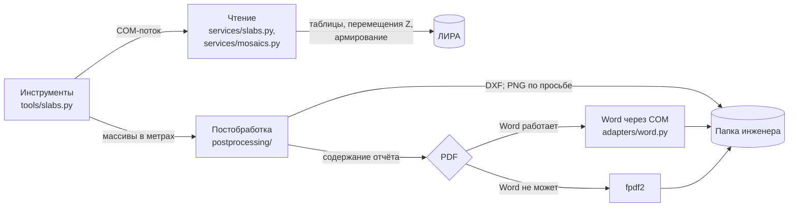
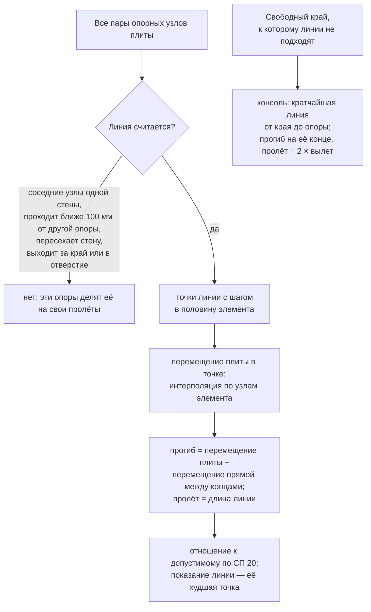

# Плиты: прогибы, изополя, мозаики, отчёты

!!! info "Построено: этап 6"
    Прогибы относительно опор (`lira_slab_deflections`), копия модели с трещинами
    (`lira_cracked_copy`), мозаики армирования с DXF зон (`lira_slab_reinforcement`),
    отчёты Word и PDF.

## Что делает

Инженер просит, например: «проверь прогибы плит по нормативной длительной РСН и
сделай отчёт». Агент вызывает один инструмент; сервер сам читает сетку модели и
результаты, находит плиты и их опоры, считает прогиб по линиям между опорами,
рисует изополя и пишет отчёт. Агенту возвращается короткая сводка по плитам — десятки
строк, а не сотни тысяч перемещений.

## Место в архитектуре



Как читать: чтение из ЛИРЫ идёт в COM-потоке, как у всех инструментов; счёт и картинки —
в отдельном потоке на массивах, без ЛИРЫ. Модуль `postprocessing/` не знает ни ЛИРЫ, ни
COM ([0003](../decisions/0003-postprocessing.md)); Word — внешняя программа, поэтому его
адаптер лежит в `adapters/` ([0005](../decisions/0005-reports.md)).

## Как сервер видит плиту

- **Плита** — связная (через общие узлы) часть изгибаемых пластин и оболочек (КЭ 11,
  12, 15–17, 19, 41, 42, 44–47 и их нелинейные аналоги), у каждой из которых узлы лежат
  на одной отметке с точностью 5 мм. Допуск проверяется по пластине, поэтому пологий
  уклон на мелкой сетке остаётся одной плитой. Плиты нумеруются снизу вверх.
- **Опора** — узел плиты, который держит что-то **снизу**: стержень или пластина,
  уходящие вниз (колонна, стена, пилон), связь по Z, одноузловой элемент (упругая опора,
  свая), АЖТ «все степени свободы» или объединение перемещений по Z с таким узлом.
  Колонны и стены следующего этажа (сверху) плиту нагружают и опорами не считаются.
  Если АЖТ держат только одноузловые упругие элементы, все его узлы считаются узлами на упругих
  опорах; если есть что-то ещё (колонна, связь) — узлами на колонне. Узел, у которого есть и стержень
  вниз, и одноузловой элемент, держит стержень, в каком бы порядке элементы ни шли в модели. Когда решается,
  составляют ли упругие опоры большинство, АЖТ считается одной опорой: пружина под АЖТ из 9 узлов не перевешивает
  четыре колонны. Группы с общим узлом считаются одним телом: АЖТ, повторённое объединением перемещений, — одна опора.
- **Граница** — рёбра пластин, принадлежащие одной пластине: внешний контур и края
  отверстий.
- **Плита, которая считается по осадке** (решение владельца 2026-11-07, `Slab.on_foundation`) —
  плита на упругих элементах в одном из двух видов:
    - **Одноузловые упругие элементы** составляют больше половины её опорных узлов. Тип элемента не важен:
      упругая опора, связь с заданной жёсткостью, свая (КЭ 51, 56, 57 и аналоги 2xx). Они могут стоять под
      всей плитой или под отдельными точками. Пример 22 ЛИРЫ: 31 свая на 289 узлов и других опор нет. Жёсткие
      связи по Z осадкой не считаются: опора там не смещается.
    - **Коэффициенты постели C1, C2** заданы больше чем у половины её пластин (таблица `Plates_C1C2`). Опорных
      узлов у такой плиты может не быть совсем. Пример 04 ЛИРЫ: 520 из 520 пластин.

  Пролётов между опорами у такой плиты нет: прогиб и предел СП 20 не считаются (см. раздел «Фундаменты»).
  Перекрытие на колоннах с одним-двумя упругими элементами остаётся прогибом, и отчёт говорит, сколько таких
  элементов. На модели владельца признаки разделяют плиты чисто: у плит 1–3 упругие опоры у 98–99 %
  узлов, у остальных 25 их нет. Маркеры опор не рисуются, только когда они стоят больше чем у половины узлов:
  они закрасили бы плиту чёрным.
- **Что стоит на плите** (`Slab.carried`) — узлы плиты, от которых идёт вверх стержень или
  пластина, и узлы АЖТ с таким узлом; `Slab.structures` — те же узлы по конструкциям. Нужно
  фундаментам.

## Прогиб относительно опор

Прогиб оценивается **по линии**, как по линии взгляда: берётся прямая между двумя точками
опор, и прогиб смотрится только в точках самой этой прямой. Так решил владелец
(2026-11-05); раньше сервер брал узел плиты и сносил его на линию, проведённую рядом, и это было
неверно: точка наибольшего прогиба панели обычно лежит в стороне от всех линий.



Как читать: каждая линия даёт одно показание, в своей худшей точке. Чем больше опор, тем больше
линий: на самой большой плите модели владельца их десятки тысяч.

Уточнения, найденные на тестах и на модели владельца:

- **Через другую опору линия не идёт.** Опора ближе 100 мм от прямой делит линию на две, потому
  что точно через точку линия пройти может только случайно; 100 мм — принятое значение
  (`SUPPORT_CLEARANCE`).
- **Стена — это опора целиком.** Соседние узлы одной стены линией не считаются; линия поперёк
  стены останавливается ею, даже если сетка стены крупнее сетки плиты и линия проходит между её
  узлами.
- **Плита на опорах почти во всех узлах** (больше 1000 опор и больше половины узлов, но не
  одноузловые упругие опоры: связи по Z, грунт объёмными элементами) пролётов не имеет: ответ и
  отчёт так и говорят, а поиск линий на ней занял бы часы.
- **Край плиты и отверстия** останавливают линию. Линия, которая идёт вдоль края или касается
  угла отверстия, не выходя из плиты, считается.
- **Консоль.** Вылет — кратчайшее расстояние от свободного края до опоры (решение владельца): из
  узлов края берутся те, что ближе к опоре, чем их соседи по краю, а при стене вдоль края — все.
  Прогиб смотрится на конце линии, на краю, относительно опоры. Прежний расчёт вёл линию от
  каждого узла края к его опоре: от колонны веером, и вылет у края между колоннами получался 4 м
  при расстоянии до края 1,2 м.
- **Перемещение в точке** берётся из элемента, в который точка попала, по его узлам (линейная
  интерполяция по треугольникам сетки): точка редко совпадает с узлом. Вырожденная пластина без
  площади ничего не читает, поэтому плохая сетка не останавливает расчёт. Шаг точек — половина
  обычного элемента: в сильно измельчённой зоне линия может перешагнуть элемент.
- **Знак как в ЛИРЕ** (решение владельца): минус — плита ниже прямой, плюс — выше (выгиб). С допустимым
  сравнивается абсолютная величина. Так же записаны осадка и наибольшее перемещение плиты.
- **Допустимый прогиб** — СП 20.13330, табл. Д.1, п. 2а (перекрытия, открытые для
  обзора): по умолчанию для помещений высотой до 6 м (решение владельца), агент может
  выбрать помещения выше 6 м. Между точками таблицы интерполируется сам предел (мм);
  у консоли пролёт — двойной вылет.
- **Наинизшая точка панели** (`panel_lows`) не оценивается ни по какой линии: она подписывается на
  изополе своим перемещением, в каждой панели. Панель определяется по самой плите: это впадина
  глубиной от 1 мм, считая от дна до уровня, где она сливается с более глубокой впадиной.

Так это записано в коде — для всех точек пачки линий сразу: `w_line` — перемещение прямой, `span` —
пролёт, `f` — прогиб, `ratio` — отношение к допустимому. Линии дают числа и проверку; изополя считаются
иначе, см. раздел «Изополя прогиба».

```python title="src/lira_sapr_mcp/postprocessing/deflection.py, функция _read_block"
--8<-- "src/lira_sapr_mcp/postprocessing/deflection.py:readings"
```

Плита многоэтажной модели опускается вместе с колоннами; относительный прогиб меньше
абсолютного перемещения ровно на перемещение прямой между опорами (укорочение колонн).
Это проверено на трёхэтажной раме (пример №8).

## Изополя прогиба

Изополя считаются по одному правилу во всех узлах (решение владельца): перемещение узла минус перемещение
поверхности через опоры, `_through_supports`.

- **Между опорами** поверхность — плоскость через три опоры: опоры соединены в треугольники Делоне.
- **За крайними опорами** — прямая между двумя ближайшими опорами, в точке напротив узла.
- **Опоры в одну линию** — только эта линия; одна опора — её уровень.

Белых зон поэтому нет. Раньше значение получал только узел рядом с линией, а брал он значение ближайшей
точки линии: у края плиты оставались белые полосы, а контуры были рваными.

**Проверка владельца:** если все опоры в нуле, изополя обязаны совпасть с перемещениями ЛИРЫ. Плита
5 × 4 пролёта по 6 м на 30 точках, жёстких по вертикали, посчитанная в ЛИРЕ: совпадение 0,0000 мм во всех
3655 узлах, тот же тест есть среди живых. Сравнивались значения в узлах, а не сами картинки ЛИРЫ.

Когда опоры смещаются по-разному, цвет изополя и число участка в той же точке могут расходиться: участок
относится к своей линии, а изополе — к ближайшим опорам. На плите 7 это 21,33 мм по линии 9,82 м и 19,19 мм
на изополе, на плите 10 — 30,93 и 21,13 мм. Проверка по пределу остаётся по линиям.

Отношение к допустимому на изополе — это |f| этого поля к пределу для пролёта линии, проходящей у узла. Узел
без линии внутри опор берёт предел ближайшего узла на линии и только показывается: так решено для точки вне
линий. Узел без линии за крайними опорами берёт предел консоли от ближайшей опоры, а при превышении становится
отдельным участком. На модели владельца таких нет: отношение больше 1 только в 6 узлах плиты 13, и они на
линии.

## Пример №9: модель паркинга

Копия модели владельца 157-STLB-(02_06)_v9 (228 тыс. узлов, 28 плит, стадии монтажа),
нормативное длительное РСН. Коэффициенты сочетаний ЛИРА не отдаёт, поэтому РСН найдено
подбором: перемещения по каждому РСН разложены на перемещения загружений
([находки](../research/lira-api.md)). Отчёт по прогибам всех плит занимает от 85 до 309 с: чтение из
ЛИРЫ около 39 с, остальное — расчёт линий и картинки.

Разброс найден опытом: Windows считает процесс без окна на переднем плане фоновым, замедляет его и
переносит на экономичные ядра. Расчёт плиты 6 без ЛИРЫ, по несколько раз подряд: на производительных
ядрах 14 с, на экономичных 29–36 с, как решит Windows — 21–28 с, с просьбой не замедлять — 10 с. С
этой просьбой отчёт занимал 97–98 с, но её убрали: владелец решил, что работа агента не должна
мешать программам, в которых работает пользователь (2026-11-05). Если плита большая, линии считаются
дольше: чем больше опор, тем больше пар.

Самое опасное место — плита 13: линия длиной 1,21 м у стены, f/fu = 1,46. Это выгиб: узел стены
опустился на 87 мм, а плита в 0,3 м от него — на 68 мм, разность перемещений самой модели, которую
инструмент показывает инженеру. На пролётах 7–12 м отношение к допустимому 0,4–0,9. Фундаментные
плиты 1–3: осадка до −126 мм при пределе 150 мм по абсолютной величине, участков с превышением Δs/L предела 0,003 — 2, 16 и 16;
наибольшая 0,0039 при L = 2,40 м, 0,0044 при 5,95 м и 0,0047 при 6,80 м.

Мозаики той же модели: 28 плит, отчёт, 28 файлов DXF — от 141 до 521 с по той же причине; со значениями арматуры DXF стал больше: всего 230 МБ, самый большой 28 МБ.

Что выяснилось на большой модели:

- номера узлов из ответа ЛИРЫ сервер читает по одному (`Count`, `Item`), а не текстом
  (`AddToString`): текстовый вызов портит память и роняет весь процесс сервера уже на 3000
  разрозненных номеров ([находки](../research/lira-api.md));
- имя модели не может содержать `. # * ? ,` — ЛИРА показывает окно и ничего не
  открывает, поэтому копия с трещинами называется `_kE0_5`, а сервер отказывает в таком
  имени сам.

## Одноузловой элемент без жёсткости по Z

Элемент без жёсткости по Z вертикально плиту не держит и опорой не считается: ни для осадки, ни как конец линии
прогиба (`_no_vertical_stiffness` в `services/slabs.py`). Так задан, например, боковой отпор грунта: в примерах ЛИРЫ
№09 и №11 это 320 и 605 элементов КЭ 56 с жёсткостью только по X и Y. Примечание ответа и отчёта называет, сколько
таких элементов.

- **КЭ 56** — опора, если в его жёсткости `Rz` не ноль (`Rx:200 Ry:200 Rz:0 ...`).
- **КЭ 51** имеет одно направление — опора, если это Z и жёсткость не ноль (`EF:1000 n:3 ...`, где 3 — это Z).

- **Свая (КЭ 57)** работает вдоль своей оси и такой записи не имеет, поэтому остаётся опорой. На модели из одних
  свай, как у владельца, таблицы жёсткостей не читаются вообще.
- **Элемент, у которого жёсткость об этом молчит** (нелинейные аналоги 2xx, их запись не проверялась), остаётся
  опорой ([находки](../research/lira-api.md)).
- **Локальные оси узла** (`Nodes_LocalAxes`) не учитываются: `Rz` читается как глобальный Z.

## Фундаменты

Плита на упругом основании, на сваях или с коэффициентами постели не имеет пролётов между опорами: она
проверяется по осадке (`postprocessing/settlement.py`). Пределы те же, что у сплошного основания.

- **Осадка.** Изополе со своей шкалой и подписью наибольшей. Знак как в ЛИРЕ: минус — вниз, красный — у
  наибольшей осадки. Предел задаёт агент, `settlement_limit_mm`, по умолчанию 150 мм; с ним сравнивается
  абсолютная величина, поэтому подъём больше предела — тоже превышение. Зоны за пределом обведены красной
  линией, у каждой подписано наибольшее по величине перемещение.
- **Относительная разность осадок** Δs/L = |s₁ − s₂| / L по СП 22.13330 — между конструкциями,
  опирающимися на плиту (`Slab.structures`, решение владельца 2026-11-05):
    - **Колонна** — одна точка. Колонна на АЖТ — центр АЖТ со средней осадкой его узлов: ЛИРА отдаёт
      перемещения и узлов внутри АЖТ, они различаются до 5 мм на метр, потому что АЖТ поворачивается
      как целое. Это наклон колонны, а не разность осадок. АЖТ остаётся плоским, поэтому среднее по
      узлам и есть перемещение в центре.
    - **Стена или пилон** — одна конструкция: пластины, соединённые в узлах плиты, вместе с АЖТ,
      которые они захватывают.
    - **Между разными конструкциями** — все пары точек, как бы близко они ни стояли.
    - **Внутри одной стены** — только точки не ближе 3 м (`within_a_wall_from_m`): длинная стена
      проверяется вдоль себя, а внутри пилона 1,2 м сравнивать нечего.

  Предел задаёт агент, `relative_settlement_limit`, по умолчанию 0,003. Пока предел не превышен, показана одна линия с наибольшим значением; при превышении — все
  участки с превышением: после каждого выбранного отбрасываются пары с серединой ближе 0,9 длины
  более короткой из двух (но не меньше 1 м), чтобы следующий был другим местом.
- **Вертикальная конструкция** — стержень с отклонением от вертикали до четверти высоты (подкос и
  лестница ею не считаются), пластина в вертикальной плоскости и АЖТ с таким узлом.
- На плане точками показано то, что стоит на плите, а квадратами — сваи, если они стоят под отдельными точками.

Если на плите ничего не стоит, ответ и отчёт так и говорят: разность осадок не проверена.

## Отчёт по выбранным плитам

Оба отчёта, по прогибам и по армированию, можно сделать не по всей модели: параметр `elements`
принимает номера элементов, `selected` (выделенное в окне ЛИРЫ), `visible` (видимое после
фрагментации) и результат `lira_find_elements`.

- **Номер плиты** остаётся тем же, что в отчёте по всей модели, а врезка «где плита на плане»
  показывает все плиты модели, поэтому плита 7 — это та же плита 7.
- **Имена файлов** содержат номера плит: `<модель>_slab7_deflections`, `<модель>_slab3_7_reinforcement`,
  при выборе больше четырёх плит — `<модель>_slab3-12_…`. Отчёт по всей модели называется
  `<модель>_slab_deflections`, поэтому не заменяется. Повторный отчёт по той же плите заменяет прежний.
- **Часть плиты.** Если выбраны не все элементы плиты, они считаются как отдельная плита: линии через
  остальную часть не оцениваются, а край выбора считается свободным краем, поэтому консоль у него
  может быть ложной. На половине плиты 7 наибольший прогиб получился 14,97 мм на пролёте 7,71 м, а у
  всей плиты — 21,33 мм на 9,82 м. Об этом говорят ответ (`part_of_slab`, примечание) и отчёт
  («Плита 7 (часть)», «Выбрана часть плиты: 7250 из 16577 элементов»), в именах файлов стоит `_part`.
  Для армирования это не важно: значения относятся к самим элементам.
- Несвязанные элементы одной плиты остаются одной частью, а не разными плитами.

## Трещины

`lira_cracked_copy` делает копию модели `<модель>_kE<коэф.>.lir` (точка — подчёркиванием: kE 0,5 → `_kE0_5`; ЛИРА не принимает `. # * ? ,` в имени модели) и пишет всем пластинам
плит коэффициент kE к модулю упругости (таблица `Stiffnesses_Factors`). Исходная модель не
меняется. Копию агент рассчитывает и проверяет как обычно; kE = 0,5 удваивает прогиб.

## Изополя и мозаики

- **Картинка плиты.** Плита рисуется одна, на весь план: оси кончаются на её контуре.
  Справа сверху — маленькая схема: контуры всех плит серым, эта красным с кольцом (чтобы
  найти даже самую маленькую); справа снизу — шкала или легенда.
- **Изополя** прогиба (мм) и отношения к допустимому — по треугольникам сетки, в плане. Значение в
  узле — наибольшее по отношению к допустимому из проходящих рядом линий; белым остаются места,
  рядом с которыми линий нет (на модели владельца покрыто 99–100 % узлов). Шкала прогиба своя на
  каждой плите, шаг круглый (1, 2, 2,5, 5 × 10ⁿ); шкала отношения 0–1 на всех плитах одна и та же,
  выше 1 — красным. На картинке — контур, отверстия, опоры (колонны квадратами, стены точками).
- **Опасные участки на изополях** (`worst_spans`): три, а если превышений больше — все участки с
  превышением. Самая опасная линия; затем отбрасываются показания ближе 0,9 более короткого из
  двух пролётов, и в оставшихся снова берётся самая опасная — так следующий номер оказывается в
  другом месте, а короткий пролёт рядом с длинным остаётся своим местом. Красная линия — между опорами (у консоли — от опоры до края), крест — её худшая
  точка, он всегда на линии, у консоли — на краю. На картинке только номер участка, числа по
  каждому номеру — в тексте отчёта, поэтому подписи не закрывают изополе.
- **Наинизшие точки панелей** на изополе прогиба — чёрные точки с перемещением, мм.
- **Мозаики** AS1–AS4 (AS1, AS2 — нижняя и верхняя по X, AS3, AS4 — по Y) — каждый
  элемент цветом своей полосы. Шкала — ступени в см²/м (как мозаика ЛИРЫ; для сравнения
  задают ступени ЛИРЫ) или «фон + доборы»: фоновая сетка и для каждого элемента
  наименьший добор (диаметр, шаг), которого хватает; дальше — «больше наибольшего
  добора» и «сечение не подобрано». Шкалу называет инженер, агент передаёт её параметрами
  `levels` или `background` и `addons`; если её нет, берутся ступени с круглым шагом до
  наибольшей площади. Армирование — огибающая, которую подобрала ЛИРА: от отдельного РСН в
  ЛИРЕ 2024 его не получить.
- **DXF зон** — по файлу на плиту, в миллиметрах, на каждый слой арматуры отдельный план,
  как в отчёте: AS1 и AS2 в верхнем ряду, AS3 и AS4 под ними. AS1 остаётся в координатах
  модели, остальные планы сдвинуты целиком. В каждом плане: заголовок, контур плиты (`SLAB`),
  опоры (`SUPPORTS`; у плиты с опорами почти во всех узлах их нет), зоны и легенда справа (`LEGEND`). Слой
  на направление и полосу шкалы (`AS1_add_D16s200`, `AS2_4-6`) с контурами зон и
  штриховкой. Фон зоной не считается. У каждого элемента в его центре подписана требуемая
  арматура, см²/м, как её выдаёт ЛИРА, отдельным слоем на направление (`AS1_VALUES`), чтобы легко
  выключить; высота текста — 22 % стороны элемента, «—» — сечение не подобрано.

## DXF прогибов и осадок

По просьбе инженера (`dxf=true` у `lira_slab_deflections`) — по файлу на плиту, мозаика по элементам на том же
модуле записи, что и у армирования (`postprocessing/dxf.py`, `field_plan`, решение владельца):

- **Плита с пролётами**, `<модель>_slab<N>_deflection.dxf`: два плана. Прогиб, мм (слои `F_m20_m18`, подписи
  `F_VALUES`) и отношение к допустимому (слои `RATIO_0p1_0p2`, `RATIO_over1`, подписи `RATIO_VALUES`).
- **Плита с осадкой**, `<модель>_slab<N>_settlement.dxf`: один план, слои `S_…`, подписи `S_VALUES`.
- **Шкала и цвета** те же, что на изополе этой плиты, знак как в ЛИРЕ. Подпись — с десятичной точкой, как у
  армирования.
- **Значение элемента — среднее по его узлам.** Поэтому мозаика ступенчатая, а пик в узле читается немного меньше,
  чем на изополе. Поле то же, что на изополе, значит и от чисел участков оно может отличаться.

Плита без пролётов и без осадки файла не получает. Изополя контурами в DXF нет: для них нужен перевод контуров в
штриховки, отдельная работа.

## Отчёты

Отчёт — результат по умолчанию: инструменты с `output_dir` пишут его и Word, и PDF, если
агент не сказал иначе (`report`: `docx`, `pdf`, `none`). Картинки для него рисуются во
временной папке; PNG в папке инженера появляются только по просьбе (`pictures=true` у
прогибов, `formats` с `"png"` у мозаик).

Отчёт Word (python-docx): заголовок, что и как посчитано, сводная таблица, по каждой
плите — текст, затем каждая картинка на отдельном листе. Лист повёрнут так, как плита выходит
крупнее (`plots._plan` выбирает размер рисунка, `report._fitted` — лист). Это относится и к мозаикам. Перечня номеров элементов в отчёте нет, только их число. PDF
делает Word, если он работает; если Word не установлен, не активирован или показал своё
окно, сервер останавливает свой скрытый Word и пишет PDF сам (fpdf2); ответ говорит, чем
сделан PDF (`pdf_by`). В конце отчёта — примечания: какие жёсткие тела не взяты опорами и
что модель сохранена после расчёта.

Пояснение наихудшей точки плиты (номер 1 на изополях), пример:

> Самый опасный участок: прогиб f = −35,80 мм на пролёте длиной l = 8,20 м (участок 1 на изополях), что
> составляет l/229 и не больше предельного, равного l/224,5 = 8,20 м / 224,5 = 36,53 мм.

За ним: координаты точки и ближайший узел; опоры линии, их перемещения и перемещение прямой в этой
точке; сам расчёт f; откуда взят предел (точка таблицы или интерполяция между двумя точками, с их
значениями); f / fu и вывод. Если плита оказалась выше прямой между опорами (выгиб), сказано и
это: сравнивается абсолютная величина. Для остальных показанных участков — по одной строке с теми
же числами; затем — сколько наинизших точек панелей подписано и самая низкая из них. У фундамента —
осадка, зоны сверх предела и каждый показанный участок разности осадок с её расчётом.

## Код

| Файл | Что в нём |
|---|---|
| `postprocessing/mesh.py` | Плиты, граница, опоры |
| `postprocessing/deflection.py` | Прогиб по линиям между опорами, предел СП 20, наинизшие точки панелей |
| `postprocessing/settlement.py` | Зоны осадки сверх предела, относительная разность осадок |
| `postprocessing/mosaic.py` | Шкалы мозаик, контуры и площади зон |
| `postprocessing/plots.py` | Изополя и мозаики (matplotlib) |
| `postprocessing/dxf.py` | DXF зон (ezdxf) |
| `postprocessing/report.py` | Отчёт Word и PDF |
| `services/slabs.py`, `services/mosaics.py` | Чтение из ЛИРЫ, сводки, файлы |
| `adapters/word.py` | PDF через Word с остановкой своего экземпляра |
| `tools/slabs.py` | Инструменты |
