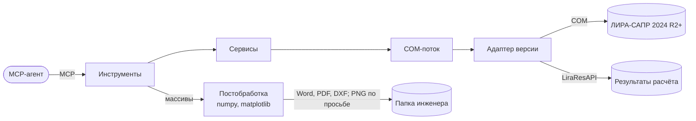

# Lira-Sapr-MCP

MCP-сервер, через который ИИ-агент управляет ЛИРА-САПР на компьютере инженера:
создаёт и редактирует расчётные модели, запускает расчёт и получает результаты.

Как читать: агент вызывает инструменты; всё общение с ЛИРОЙ идёт через один COM-поток
и адаптер версии. Плиты (прогибы, изополя, мозаики, отчёты) считает модуль
постобработки на массивах, уже без ЛИРЫ.

## Где мы сейчас

- Продукт описан и утверждён — [PRODUCT.md](PRODUCT.md).
- Архитектура утверждена — [ARCHITECTURE.md](ARCHITECTURE.md).
- Этап 1 (тонкий сквозной путь) построен: агент создаёт модель, правит таблицы и
  нагрузки, рассчитывает и получает перемещения и усилия — 20 инструментов. Пример
  приёмки №1 (рама 6×3 м) совпадает с ручным расчётом.
- Этап 2 построен: все виды результатов (усилия всех семейств КЭ, РСН, РСУ, периоды,
  арматура, нагрузки на фрагмент и продавливание) с огибающими, порогом и выгрузкой в
  CSV/Excel; сводка с признаком результатов; справочник таблиц как MCP-ресурс; правка
  модели операциями; скрипт агента. Примеры №2, №3, №4 (10 наибольших моментов каркаса
  из 11 264 стержней — одним запросом за ~2 с).
- Этап 3 построен: сервер видит модальные окна ЛИРЫ и отвечает на них, честно говорит о
  заданиях, переживших тайм-аут, откатывает модель из резервной копии и присылает
  картинку модели — всего 42 инструмента. Пример №5.
- Этап 4 построен: установка одной командой `uvx` с GitHub, ясный ответ об инструментах,
  которых нет в этой версии ЛИРЫ, отчёт `--diagnose` для других версий, выключатель
  скриптов `--no-scripts`, README и [страница инструментов](tools.md). Сервер опубликован:
  [k3nsu1/LIRA-SAPR-](https://github.com/k3nsu1/LIRA-SAPR-).
- Первая версия готова. Не проверено: пример №6 (другой компьютер с ЛИРОЙ 2024 R2) и
  ЛИРА 2025/2026 — нет доступа.
- Вторая версия ([продукт](PRODUCT.md), «Вторая версия»), этапы 5–8; на GitHub пока не
  публикуется. Этап 5 построен: элементы указываются выделением в окне ЛИРЫ, видимостью
  после фрагментации и поиском по признакам; нагрузки только у них (пример №7).
- Этап 6 построен: [плиты](components/slabs.md) — прогиб относительно опор по СП 20,
  изополя, копия с трещинами (kE), мозаики армирования AS1–AS4 с DXF зон, отчёты Word и
  PDF — 47 инструментов. Примеры №8 (балочная плита, консоль, рама — совпадают с
  теорией) и №9 (модель паркинга 228 тыс. узлов, 28 плит за 2,5–6 мин); пример №10
  (сравнение мозаики с ЛИРОЙ, DXF в программе чертежей) проверяет владелец.
  Дальше — этап 7 (пробы на живой ЛИРЕ), см. [TASKS.md](TASKS.md).

## С чего начать чтение

1. [Что мы делаем](PRODUCT.md)
2. [Как устроено](ARCHITECTURE.md) и [сервер изнутри](components/server.md)
3. [Главный сценарий](flows/main-scenario.md) и [плиты](components/slabs.md)
4. [Как запустить и подключить к агенту](operations.md)
5. [Что умеет API ЛИРЫ](research/lira-api.md)
